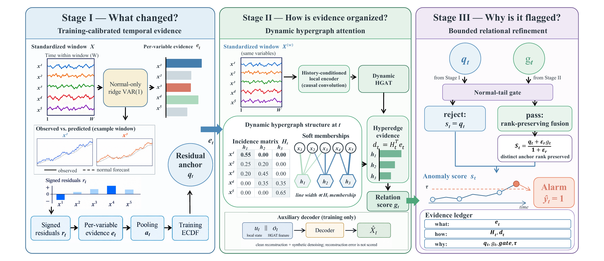

# ISTAD: Interpretable Spatio-Temporal Anomaly Detection for Multivariate Time Series via Rank-Preserving Hypergraph Refinement

Haoyang Zeng<sup>a,1</sup>, Gujie Shao<sup>b,1</sup>, Yuancheng Xia<sup>c,1</sup>, Yuanxi Fu<sup>a</sup>, Yuming Yang<sup>a</sup>, Xiao Sun<sup>a</sup>, Rong Tang<sup>d</sup>, Kaiwen Wei<sup>a,*</sup>, Jiang Zhong<sup>a,*</sup>

<sup>a</sup> School of Computer Science, Chongqing University, Chongqing, China  
<sup>b</sup> School of Computing, National University of Singapore, Singapore  
<sup>c</sup> China Telecom Zhejiang Branch, China  
<sup>d</sup> Chongqing Center for Disease Control and Prevention, Chongqing, China

<sup>1</sup> Equal contribution.  
<sup>*</sup> Corresponding authors: [weikaiwen@cqu.edu.cn](mailto:weikaiwen@cqu.edu.cn), [zhongjiang@cqu.edu.cn](mailto:zhongjiang@cqu.edu.cn).

**Manuscript under review at Knowledge-Based Systems, November 2026.**



*Figure 2 of the manuscript. ISTAD follows one evidence-constrained decision path: training-calibrated residuals establish what changed, dynamic HGAT records how the evidence is organized, and gated rank-preserving fusion specifies how relational context is bounded in the final score without reversing a distinct anchor rank. Membership values and traces are illustrative.*

## Overview

ISTAD is an evidence-constrained framework for multivariate time-series anomaly detection. It separates anomaly scoring into three stages:

1. **What changed? Training-calibrated temporal evidence.** A one-step ridge vector autoregression fitted on normal observations produces signed per-variable residuals, per-variable evidence, and a training-calibrated anchor score. No learned relation is involved at this stage.
2. **How is the evidence organized? Dynamic hypergraph attention.** Factorized dynamic HGAT infers sparse, state-dependent variable–hyperedge memberships over the same evidence and routes it into hyperedge contributions and a relation score.
3. **Why is it flagged? Bounded relational refinement.** A normal-tail gate decides whether the relation view is admitted. When admitted, a rank-preserving fusion rule bounds its correction: relational context may refine ties in the empirical anchor ranking but cannot reverse the ordering between distinct anchor scores.

The order of these stages is an architectural commitment. Temporal evidence is established before HGAT is consulted, HGAT organizes rather than replaces it, and the final rule governs how the relational view enters the anomaly score. The learned memberships are model-internal associations used by this decision process, not a uniquely recovered physical or causal graph.

## Contributions

- An evidence-constrained architecture in which a predictor fitted on normal data supplies variable evidence and a calibrated anchor, while dynamic HGAT organizes the same evidence through higher-order relational context without serving as an independent detector.
- A normal-tail gate for relational admission and a rank-preserving fusion rule that bounds accepted corrections, formally preserves distinct anchor orderings, and exposes each correction for audit.
- A protocol-separated evaluation on EXATHLON, PSM, SMD, and SWaT, together with audits of rank safety, cross-channel message utility, variable localization, real-event decision tracing, and computational efficiency.

## Main results

Results from the manuscript over seeds 87, 90, and 98. Dataset entries are three-seed means; the final column is the macro mean of the four dataset means.

| Metric | EXATHLON | PSM | SMD | SWaT | Macro mean |
|---|---:|---:|---:|---:|---:|
| ROC-AUC | 0.8275 | 0.6551 | 0.6815 | 0.8500 | 0.7535 |
| AP | 0.4263 | 0.4277 | 0.1172 | 0.5293±0.0004 | 0.3751 |
| POT+PA F1 | 0.9593 | 0.9697 | 0.8478 | 0.8323 | 0.9023 |
| Best-F1+PA (oracle) | 0.9628 | 0.9822 | 0.8829 | 0.9524 | 0.9451 |

Under the shared point-adjusted compatibility protocol, ISTAD reaches a macro F1 of 0.9023, a 2.7% relative improvement over the strongest evaluated external baseline. Across 12 dataset–seed runs, no pairwise ordering between distinct anchor scores is reversed. Controlled injections yield above-chance variable localization on all four datasets, masked-channel audits confirm the utility of cross-channel message passing, and real-event audits trace individual alarms from variable evidence through hyperedge contributions to the threshold decision.

POT+PA is a shared compatibility protocol, not a deployment calibration. Best-F1+PA uses test labels and is therefore an oracle upper bound. Point adjustment can inflate the apparent performance of sparse-spike detectors, so the point-wise AP and ROC-AUC rows above are reported without PA as complementary views. The macro mean is descriptive.

## Repository layout

```text
.
├── code/ISTAD/                 # Model, training/evaluation pipeline, frozen scripts
├── code/Time-Series-Library/   # External baseline code
├── code/TranAD_improve/        # External baseline code
├── code/TranAD_upstream/       # External baseline code
├── analysis/                   # Paper-facing evaluators and machine-readable results
├── checkpoints/                # Frozen checkpoints for evaluation-only runs
├── results/                    # Archived result artefacts
├── paper/                      # Manuscript figures and method notes
├── EXPERIMENTS.md              # Frozen experiment record, negative results, evidence boundaries
└── LICENSE
```

The frozen experiment record in [EXPERIMENTS.md](EXPERIMENTS.md) documents the protocols, the development branches that were stopped, and the evidence boundaries. It is the authoritative source for how the reported numbers may be used; this page summarizes the manuscript and does not replace that record.

## Getting started

### Environment

The released environment targets Python 3.11 and PyTorch 2.5.1 with CUDA 12.1.

```bash
pip install -r code/ISTAD/requirements.txt
```

CPU-only execution is supported with `--no_use_gpu`, although the released protocols were run on GPUs.

### Data

Datasets are not redistributed. `--root_path` must point to a directory containing the files below. For PSM, MSL, SMAP, SMD, and SWaT the loaders can fall back to downloading `thuml/Time-Series-Library` from Hugging Face; EXATHLON is local-only and raises an error if its files are absent.

| Dataset | Files expected in `--root_path` | Notes |
|---|---|---|
| PSM | `train.csv`, `test.csv`, `test_label.csv` | The first CSV column is treated as an index and dropped. |
| MSL | `MSL_train.npy`, `MSL_test.npy`, `MSL_test_label.npy` | Entity lengths are fixed in `data_loader.py`. |
| SMAP | `SMAP_train.npy`, `SMAP_test.npy`, `SMAP_test_label.npy` | Same convention as MSL. |
| SMD | `SMD_train.npy`, `SMD_test.npy`, `SMD_test_label.npy` | Entity-aware training keeps windows and PA inside each machine. |
| SWaT | `swat_train2.csv`, `swat2.csv` | The binary label must be the last column of `swat2.csv`. |
| EXATHLON | `Exathlon_train.npy`, `Exathlon_test.npy`, `Exathlon_test_label.npy` | Must be provided locally. |

Arrays are expected as `(time, channels)` numeric arrays with binary labels per time point. Do not redistribute datasets whose licences do not permit it; obtain them from their official sources.

### Train and evaluate

The frozen scripts under `code/ISTAD/scripts/anomaly_detection/` are the canonical entry points. Arguments are dataset, GPU, seed, and mode (`train` or `eval`).

```bash
cd code/ISTAD

# Train the released anchor + hypergraph configuration on PSM (GPU 0, seed 87)
bash scripts/anomaly_detection/ISTAD_v4_hgat_integrated.sh PSM 0 87 train

# Evaluation-only pass from the matching frozen checkpoint
bash scripts/anomaly_detection/ISTAD_v4_hgat_integrated.sh PSM 0 87 eval
```

The scripts read `ISTAD_DATA_ROOT`, `ISTAD_CHECKPOINT_ROOT`, and `ISTAD_RESULT_ROOT` where applicable. Evaluation-only runs require checkpoints produced by a training run with the same arguments and seed. See [code/ISTAD/README.md](code/ISTAD/README.md) for the direct CLI, the full option table, and the output layout.

### Re-evaluate the paper from frozen checkpoints

From the repository root:

```bash
bash code/ISTAD/scripts/anomaly_detection/ISTAD_v4_hgat_paper_eval.sh 0
```

This regenerates the float64 score artefacts from the frozen checkpoints and runs the paper-facing evaluators under `analysis/`. It performs no training and no hyperparameter selection. The script covers EXATHLON, PSM, SMD, and SWaT with seeds 87, 90, and 98.

## Paper-to-code map

| Manuscript component | Implementation | Entry point or flag |
|---|---|---|
| Stage I: normal-only ridge VAR, signed innovations, training ECDF anchor | [code/ISTAD/utils/innovation.py](code/ISTAD/utils/innovation.py) | `--istad_score_mode innovation*` |
| Stage II: dynamic hypergraph organization | [code/ISTAD/models/istad_layers/hypergraph_attention.py](code/ISTAD/models/istad_layers/hypergraph_attention.py) | `--istad_spatial_type lite`, `--istad_hgat_relation_mode dynamic` |
| Stage III: normal-tail gate and rank-preserving fusion | [code/ISTAD/utils/innovation.py](code/ISTAD/utils/innovation.py), `training_only_hgat_reliability_gate`, `rank_safe_hgat_refine` | `--istad_hgat_fusion_strategy rank_tiebreak` |
| Training, scoring, thresholds, point adjustment | [code/ISTAD/exp/exp_anomaly_detection.py](code/ISTAD/exp/exp_anomaly_detection.py) | `--use_bestf1_threshold`, `--bestf1_use_adjustment` |
| Interpretability and localization audits | [code/ISTAD/exp/exp_anomaly_detection.py](code/ISTAD/exp/exp_anomaly_detection.py), [analysis/evaluate_v4hg_interpretability.py](analysis/evaluate_v4hg_interpretability.py) | `--istad_enable_explain 1` |
| Event-level metrics | [code/ISTAD/utils/event_metrics.py](code/ISTAD/utils/event_metrics.py) | Reported in `analysis/` |
| Paper evaluators and efficiency benchmark | [analysis/evaluate_v4_hgat_paper.py](analysis/evaluate_v4_hgat_paper.py), [analysis/benchmark_v4_hgat_efficiency.py](analysis/benchmark_v4_hgat_efficiency.py) | `ISTAD_v4_hgat_paper_eval.sh` |

The internal experiment names retain development labels such as V4-HG. They refer to the released anchor-plus-refinement implementation and are kept so that scripts, checkpoints, and archived results remain traceable.

## Tests

```bash
python -m unittest discover -s code/ISTAD/tests -v
```

The tests are unit and smoke tests; a few reference `analysis/` and expect the full release layout.

## Citation

```bibtex
@misc{zeng2026istad,
  title        = {ISTAD: Interpretable Spatio-Temporal Anomaly Detection for Multivariate Time Series via Rank-Preserving Hypergraph Refinement},
  author       = {Zeng, Haoyang and Shao, Gujie and Xia, Yuancheng and Fu, Yuanxi and Yang, Yuming and Sun, Xiao and Tang, Rong and Wei, Kaiwen and Zhong, Jiang},
  year         = {2026},
  note         = {Manuscript under review at Knowledge-Based Systems},
  url          = {https://github.com/yuanyuanyuantang/ISTAD}
}
```

The manuscript is under review. Venue and DOI will be added here once they are final.

## License

MIT. See [LICENSE](LICENSE).
